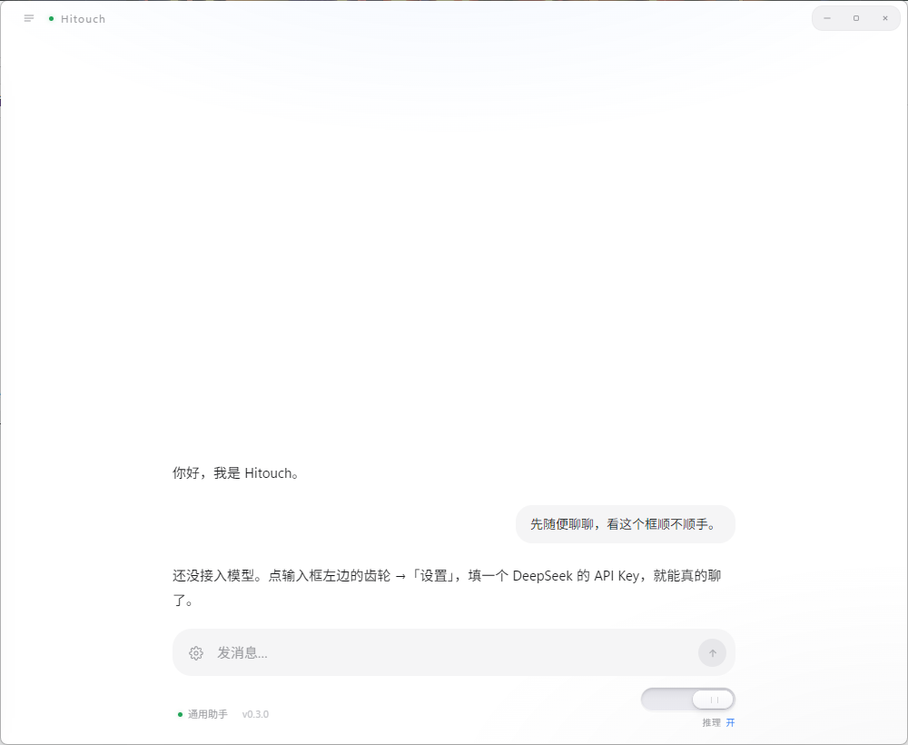
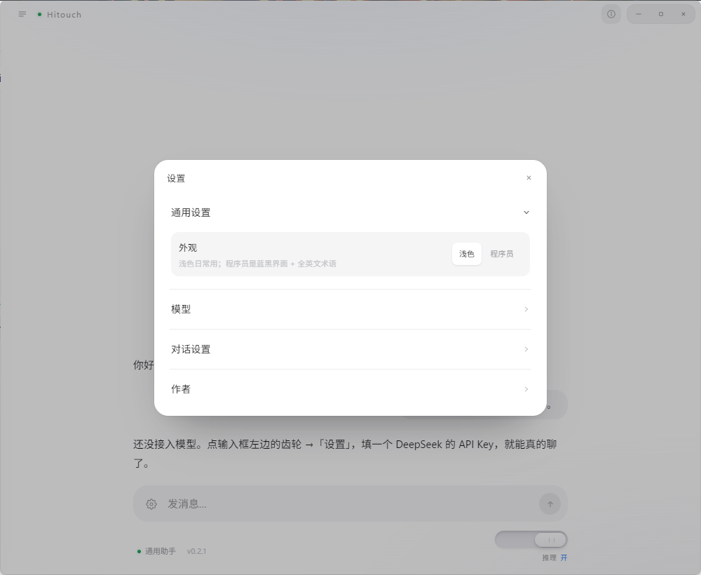
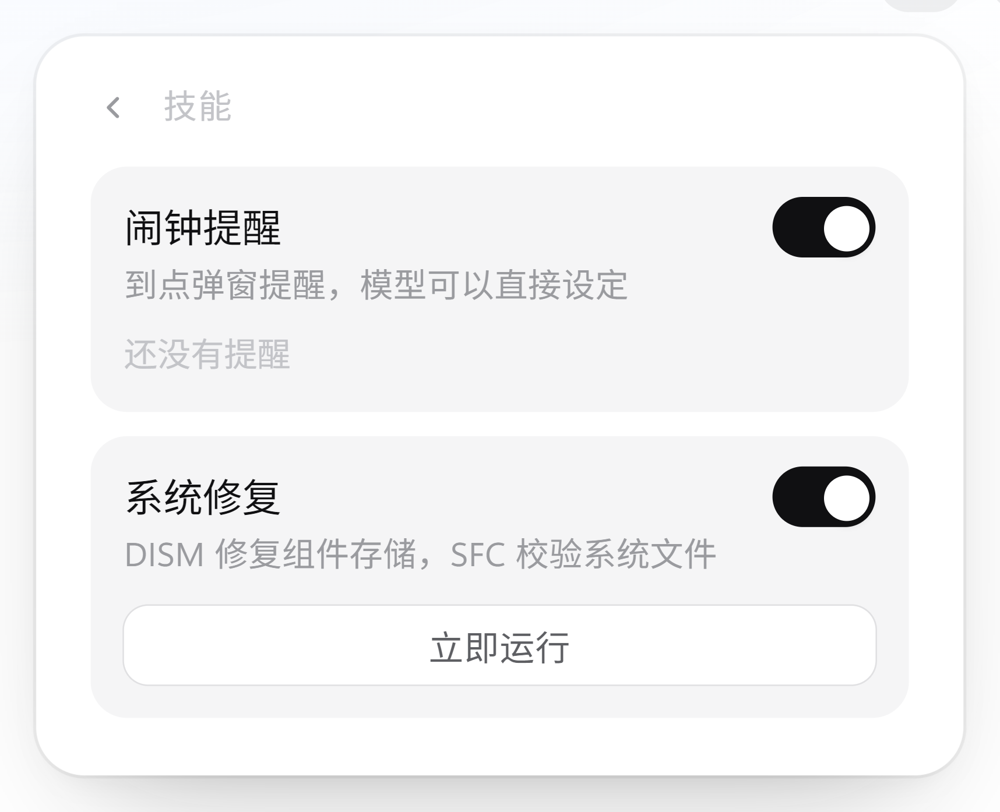

<div align="center">

# Hitouch

A quiet desktop client for talking to DeepSeek.

**DeepSeek desktop client for Windows x64** — bring your own API key and start chatting: no sign-up, no account, no telemetry. **Chats are not saved by default** — close the window and they're gone. Turn on "Save conversations" and they're encrypted on your machine with Windows DPAPI. A no-install portable build is included.

> Where your data goes: every message you send is processed by DeepSeek. If you turn on web search, your search queries go to the search engine. Nothing else leaves the machine.

<sub>Windows x64 · 0.2.0 · MIT</sub>

<sub>[中文](README.md) · **English**</sub>

<br />



</div>

---

## About

Hitouch is a chat client that runs on your machine. It does not provide a model and does not host anything — you supply your own API key, your messages go straight to DeepSeek, and the reply comes straight back to the window.

No account in between, no sync, no relay layer.

## Design

Everything on screen is necessary; the rest was removed. Concretely:

- **No permanent sidebar.** Conversations live behind the button in the top-left; pull them out when needed.
- **No cloud sync.** Records stay inside the current Windows account.
- **No settings maze.** Every option lives in a single panel, readable in one glance.
- **No shortcut reference.** Enter sends, Shift + Enter breaks the line. That's all.
- **No themes, skins, or plugin marketplace.** White is white.

The icons were drawn one by one rather than pulled from an icon set.

<details>
<summary>Settings panel and built-in skills</summary>

<br />

| Settings | Skills |
| --- | --- |
|  |  |

</details>

## Features

**Conversation**
Streamed output with headings, lists, tables, quotes, inline code, and highlighted code blocks. Stop a reply mid-stream, or ask for another one.

**Local history**
Off by default. Turn it on and conversations are encrypted with Windows DPAPI and stored on this machine — pull the drawer from the top-left to revisit them. Never uploaded, never synced.

**Personas**
Four built-ins — general, study tutor, coding partner, translator — plus your own.

**Web search**
Off by default. Once enabled, the model searches Bing / Baidu by itself for news, prices, weather and other live facts, and cites its sources. No API key needed.

**Local memory**
Off by default. Once enabled, say "remember I prefer…" and it writes the note into a local encrypted file; view or wipe it anytime.

**Export**
Save any conversation as Markdown.

**Reasoning toggle**
The rail at the bottom-right of the composer controls whether the model thinks before answering. Off is faster; on is steadier.

**Models**
DeepSeek-V4.1-Flash and DeepSeek-V4-Pro, switchable at any time.

**Skills**
Two are built in, each can be turned off independently:

- **Alarm** — say "remind me at eight tomorrow" and the model turns it into a scheduled task that pops up a notification on time.
- **System repair** — runs Windows' own DISM and SFC to verify and repair local system files. Requests elevation when needed, and writes a separate log file for every run.

**Terms**
On first launch you must read and accept the terms of use and the minors protection notice. The version and acceptance time are recorded locally.

## Download

Two builds, identical in function. Pick either.

| File | Notes |
| --- | --- |
| `Hitouch-0.2.0-portable.exe` | Portable. Double-click to run, writes nothing to the registry, fits on a USB stick. |
| `Hitouch-0.2.0-setup.exe` | Installer. Choose the install directory, creates Start menu and desktop shortcuts, uninstalls from Apps & features. |

Get them from [Releases](https://github.com/Sun2530/Hitouch/releases). The size is large because the Electron runtime is bundled.

## First run

1. Open the app and click the top-right corner to reach **Model & access**
2. Enter a DeepSeek API key (create one at [platform.deepseek.com](https://platform.deepseek.com/api_keys))
3. Pick a model, save

The key is encrypted with Windows DPAPI and written to your local user directory immediately; only the current Windows account can decrypt it. Validating the key sends a single `GET /models` and costs no tokens.

## Build

Requires Node.js 18 or newer.

```bash
npm install
npm start        # development mode
npm run dist     # emits the portable build and installer into dist/
```

The stack is Electron plus plain HTML/CSS/JS. No frontend framework, no bundler, no build artifacts in the repository.

## Data

- **API key** — DPAPI-encrypted, stored locally, never uploaded.
- **Conversations** — never written to disk by default. If you enable history in Settings, they are DPAPI-encrypted into `%APPDATA%\Hitouch\conversations`. Never uploaded or synced.
- **Local memory** — off by default; when on, stored encrypted locally and always viewable and erasable.
- **Web search** — off by default; when on, only the search keywords go to Bing or Baidu.
- **Alarms** — kept on disk so they can fire on time.
- **Telemetry** — none.

Apart from DeepSeek and the search engine you explicitly turned on, the app contacts no server.

## Note

A personal project, maintained by one person, with no promised release cadence. The terms of use inside the app also apply to builds obtained from this repository.

## License

[MIT](LICENSE) © 2026 Sun2530
