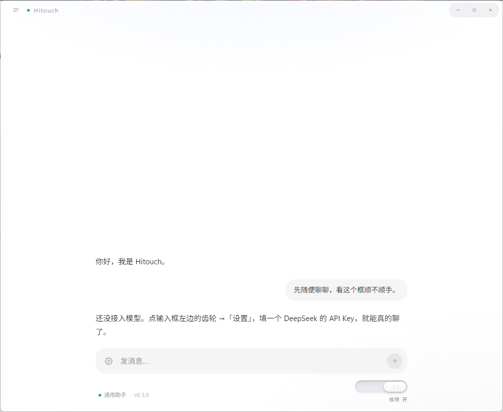
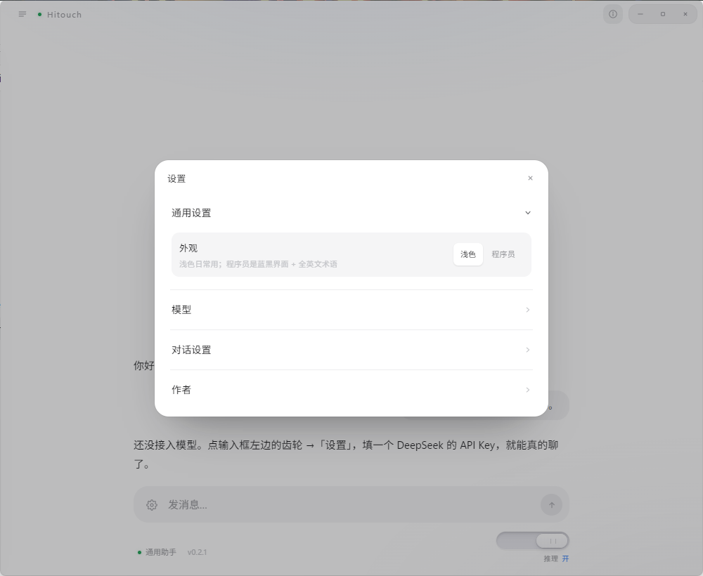
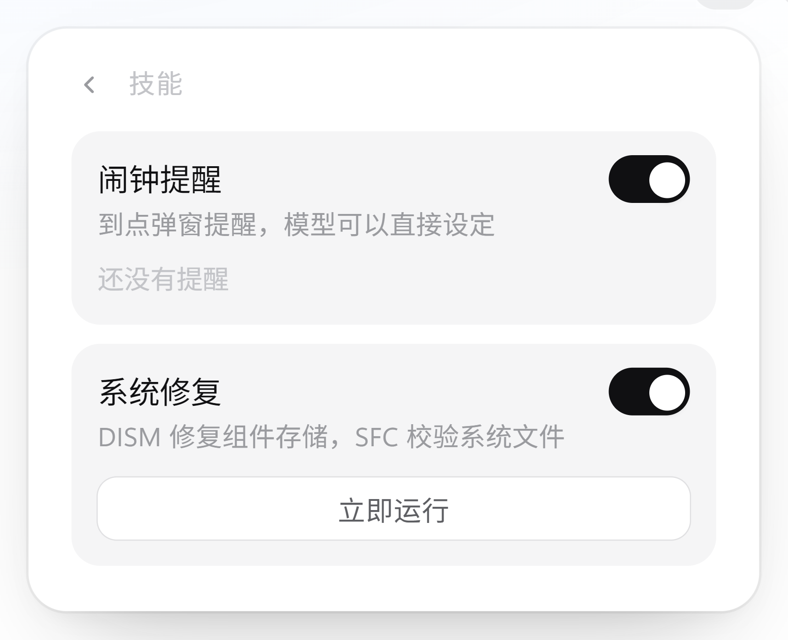

<div align="center">

# Hitouch 💬

**一个安静的 DeepSeek 桌面客户端 —— 本地 API Key · 无账号 · 无遥测**

**DeepSeek 桌面客户端 / DeepSeek 客户端下载（Windows x64）** —— 填入自己的 API Key 就能对话：不注册、不登录、不上传聊天记录。**聊天记录默认不保存**，关窗即清；想留再在设置里打开「保存对话记录」，用 Windows DPAPI 加密存到本机。也提供免安装的便携版。

> 说清楚数据去哪：你发的每句话都会交给 DeepSeek 处理；开了联网搜索时，搜索词会交给搜索引擎。没有第三处。

**简体中文** | [English](README.en.md)

<br />

[](https://gitee.com/sunkuforgame/Hitouch/releases/v0.3.3)
[](LICENSE)
[](https://gitee.com/sunkuforgame/Hitouch/stargazers)
[](https://gitee.com/sunkuforgame/Hitouch/members)
[](https://gitee.com/sunkuforgame/Hitouch)
[](https://gitee.com/sunkuforgame/Hitouch)
[](https://gitee.com/sunkuforgame/Hitouch)

[](https://gitee.com/sunkuforgame/Hitouch)

<br />



</div>

---

## 📖 关于

Hitouch 是跑在本机的 DeepSeek 对话客户端。它不提供模型，也不托管任何服务 —— 你填入自己的 API Key，输入的内容直接发往 DeepSeek，回答直接回到窗口里。

中间没有账号，没有同步，没有一层转发。

## ✨ 功能特性

- 💬 **流式对话** —— 回答实时渲染，可随时停下，也可以让它重新生成
- 🗂️ **本地会话** —— 默认关、不打扰；打开后对话加密存在本机，左上角拉开就能翻回去；不上传、不同步
- 🎭 **人设** —— 内置通用助手、学习助教、编程搭子、翻译，也能自己写一个
- 🌐 **联网搜索** —— 默认关。打开后它自己去 Bing / 百度查新闻、价格、天气等实时信息，并在回答里注明来源
- 🧠 **本地记忆** —— 默认关。打开后对它说「记住我喜欢简洁」，它就把这条写进本地加密文件；随时查看、清空
- ✍️ **Markdown** —— 标题、列表、表格、引用、代码高亮与一键复制
- 📤 **导出** —— 任意一段对话，一键存成 Markdown
- 🧠 **推理开关** —— 输入框右下角的滑轨控制模型是否先思考再回答：关掉更快，打开更稳
- 🔀 **双模型切换** —— DeepSeek-V4.1-Flash 与 DeepSeek-V4-Pro，随时切换
- 🎛 **程序员外观**（0.3.0）—— 全英文界面 + 蓝黑配色，右侧边栏实时记录模型的深度思考过程；与浅色外观一键切换，选择会记住
- 🎚 **上下文滑轨**（0.3.0）—— 6–200 轮可调，默认 40；长对话、大项目不再被截断
- ⏰ **闹钟提醒** —— 直接说「明天八点提醒我」，模型自动转成定时任务，到点弹窗
- 🛠️ **系统修复** —— 调用 Windows 自带的 DISM 与 SFC 校验并修复本机系统文件，每次执行日志单独成档
- 📜 **使用条款** —— 首次启动需阅读并同意使用条款与未成年人保护条款，版本号与同意时间仅记录在本机

## 🎨 设计哲学

界面上的东西都是必要的，其余都删掉了：

- 🚫 **没有常驻侧边栏** —— 对话收在左上角，需要时再拉开
- ☁️ **没有云同步** —— 记录只留在当前 Windows 账户里
- 🧩 **没有设置迷宫** —— 全部选项收在一个设置面板里，四组折叠，一次只开一组
- ⌨️ **没有快捷键表** —— 回车发送，Shift + 回车换行，到此为止
- 🎭 **没有皮肤、插件市场** —— 外观只有两套：浅色与程序员（蓝黑 + 全英文），够用就好
- ✏️ **图标逐像素手绘**，没有取用任何图标库

<details>
<summary>📸 设置面板与内置技能</summary>

<br />

| 设置 | 技能 |
| --- | --- |
|  |  |

</details>

## 📥 下载渠道

- 🐙 **[GitHub 发行版](https://github.com/Sun2530/Hitouch/releases)**
- ☁️ **[码云 Gitee 发行版](https://gitee.com/sunkuforgame/Hitouch/releases)** （国内推荐，速度更快）

两种形态，功能完全相同，选一个即可：

| 文件 | 说明 |
| --- | --- |
| `Hitouch-0.3.3-portable.exe` | 👜 **便携版**。双击即用，不写注册表，可以放进 U 盘带走 |
| `Hitouch-0.3.3-setup.exe` | 💿 **安装包**。可选安装目录，创建开始菜单与桌面快捷方式，可从「应用和功能」卸载 |

> 📌 体积偏大是因为打包了 Electron 运行时，属正常现象。

## 🚀 快速上手

1. 点输入框左边的齿轮，进 **设置 → 模型**
2. 填入 DeepSeek API Key（在 [platform.deepseek.com](https://platform.deepseek.com/api_keys) 申请）
3. 选模型，保存 ✅

> 🔑 Key 会立即用 Windows DPAPI 加密后存入本机用户目录，只有当前 Windows 账户能解开。验证 Key 时只发一次 `GET /models`，不消耗 token。

## 🔨 本地构建

需要 Node.js 18 或更新版本。

```bash
npm install
npm start        # 开发模式
npm run dist     # 产出 dist/ 下的便携版与安装包
```

技术栈只有 Electron 与原生 HTML/CSS/JS —— 没有前端框架，没有打包器，没有需要提交的构建产物。

## 🔐 数据与隐私

- **API Key**：DPAPI 加密，存于本机，不上传
- **对话内容**：默认不落盘，关窗即清。在设置里打开「保存对话记录」后，才用 Windows DPAPI 加密存到本机（`%APPDATA%\Hitouch\conversations`）；不上传、不同步
- **本地记忆**：默认关。开启后加密存本机，随时可看、可清
- **联网搜索**：默认关。开启后搜索关键词会发给 Bing 或百度；不开就永远不搜
- **闹钟**：需要存在本地才能到点触发
- **遥测**：无

除 DeepSeek 和你手动打开的搜索引擎之外，软件不向任何服务器发送数据。

## 🆕 最近更新

- **0.2.0** —— 人设自定义、联网搜索（默认关）、本地会话与记忆（默认关）、Markdown 表格与代码高亮、停止生成、重新生成、导出
- 0.1.0 —— 首个公开版本

## 💬 交流反馈

- QQ 群：**686940327**，欢迎反馈问题与建议
- 也可以在 [Issues](https://gitee.com/sunkuforgame/Hitouch/issues) 中提交 Bug 或需求

## ⚠️ 说明

个人项目，单人维护，更新不承诺频率。软件内的使用条款同样适用于通过本仓库获取的版本。

exe 未做代码签名，Windows SmartScreen 会提示「未知发布者」。点 **更多信息 → 仍要运行** 即可，这不是故障。

## 📄 许可

[MIT](LICENSE) © 2026 Sun2530
