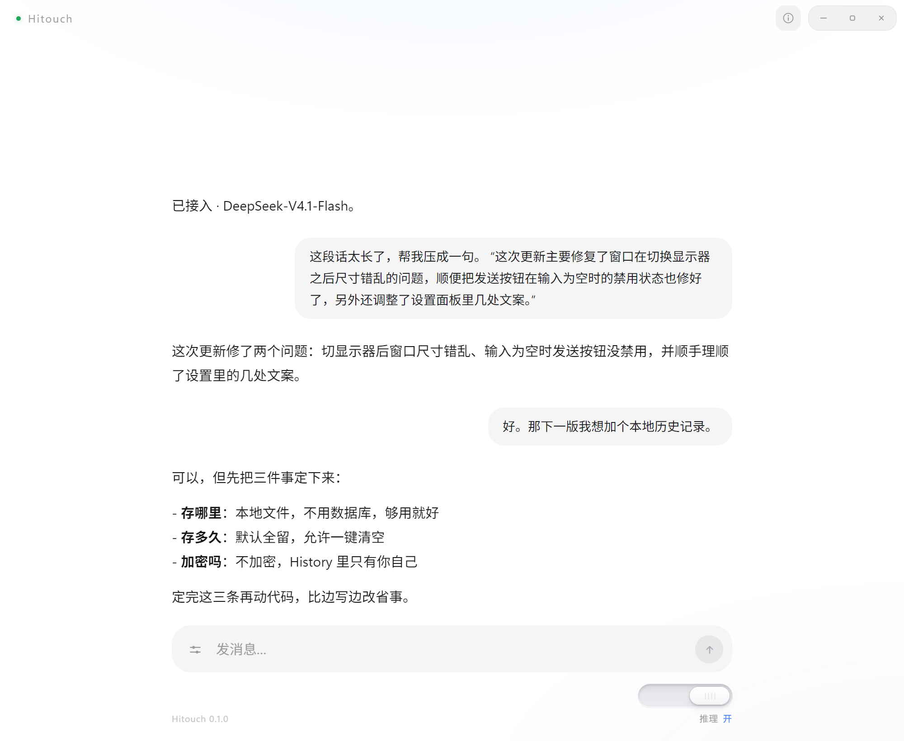
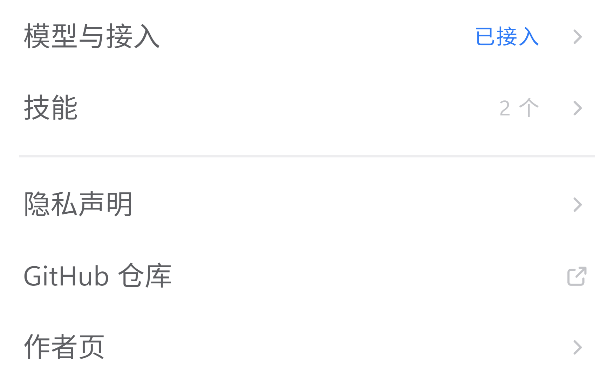
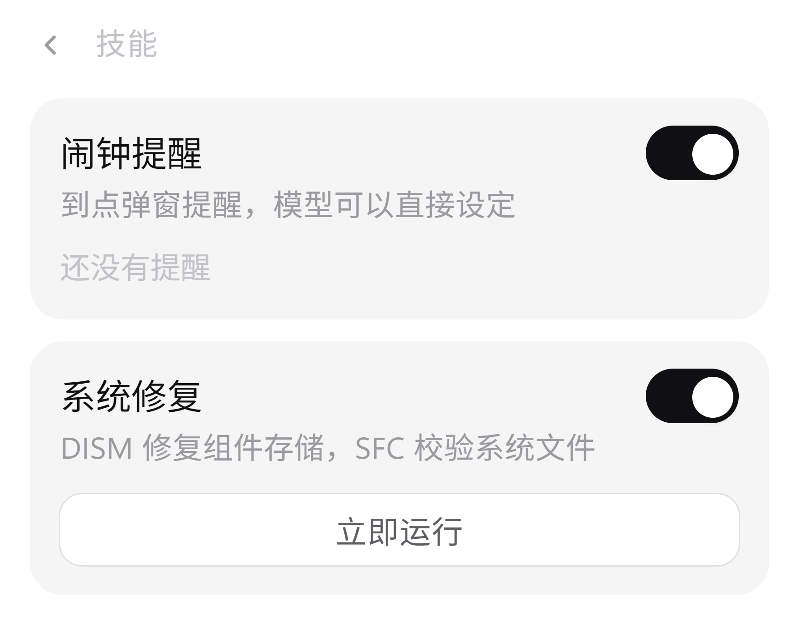

<div align="center">

# Hitouch

一个安静的桌面客户端，用来和 DeepSeek 说话。

<sub>Windows x64 · 0.1.0 · MIT</sub>

<sub>**中文** · [English](README.en.md)</sub>

<br />



</div>

---

## 关于

Hitouch 是跑在本机的对话客户端。它不提供模型，也不托管任何东西——你填入自己的 API Key，输入的内容直接发往 DeepSeek，回答直接回到窗口里。

中间没有账号，没有同步，没有一层转发。

## 设计

界面上的东西都是必要的，其余都删掉了。具体表现为：

- 没有侧边栏。历史不落盘，关窗即清。
- 没有设置迷宫。全部选项在同一个面板里，一眼看完。
- 没有快捷键表。回车发送，Shift + 回车换行，到此为止。
- 没有主题、皮肤、插件市场。白底就是白底。

图标是逐个画的，没有取用图标库。

<details>
<summary>设置面板与内置技能</summary>

<br />

| 设置 | 技能 |
| --- | --- |
|  |  |

</details>

## 功能

**对话**
流式输出，支持代码块、粗体、列表、引用与行内代码。

**推理开关**
输入框右下角的滑轨控制模型是否先思考再回答。关掉更快，打开更稳。

**模型**
DeepSeek-V4.1-Flash 与 DeepSeek-V4-Pro，随时切换。

**技能**
内置两个，可单独关闭：

- **闹钟提醒** — 直接说「明天八点提醒我」，模型会把它转成定时任务，到点弹窗。
- **系统修复** — 调用 Windows 自带的 DISM 与 SFC 校验并修复本机系统文件。需要时请求提权，每次执行的日志单独成文件。

**使用条款**
首次启动需阅读并同意使用条款与未成年人保护条款。版本号与同意时间记录在本机。

## 下载

两种形态，功能完全相同，选一个即可。

| 文件 | 说明 |
| --- | --- |
| `Hitouch-0.1.0-portable.exe` | 便携版。双击即用，不写注册表，可以放进 U 盘带走。 |
| `Hitouch-0.1.0-setup.exe` | 安装包。可选安装目录，创建开始菜单与桌面快捷方式，可从「应用和功能」卸载。 |

前往 [Releases](https://github.com/Sun2530/Hitouch/releases) 下载。体积偏大是因为打包了 Electron 运行时。

## 首次使用

1. 打开后点右上角，进入 **模型与接入**
2. 填入 DeepSeek API Key（在 [platform.deepseek.com](https://platform.deepseek.com/api_keys) 申请）
3. 选模型，保存

Key 会立即用 Windows DPAPI 加密后写入本机用户目录，只有当前 Windows 账户能解开。验证 Key 时只发一次 `GET /models`，不消耗 token。

## 构建

需要 Node.js 18 或更新版本。

```bash
npm install
npm start        # 开发模式
npm run dist     # 产出 dist/ 下的便携版与安装包
```

技术栈只有 Electron 与原生 HTML/CSS/JS。没有前端框架，没有打包器，没有需要提交的构建产物。

## 数据

- **API Key**：DPAPI 加密，存于本机，不上传。
- **对话内容**：不落盘。唯一例外是闹钟，它需要存在本地才能在到点触发。
- **遥测**：无。

除 DeepSeek 之外，软件不向任何服务器发送数据。

## 说明

个人项目，单人维护，更新不承诺频率。软件内的使用条款同样适用于通过本仓库获取的版本。

## 许可

[MIT](LICENSE) © 2026 Sun2530
